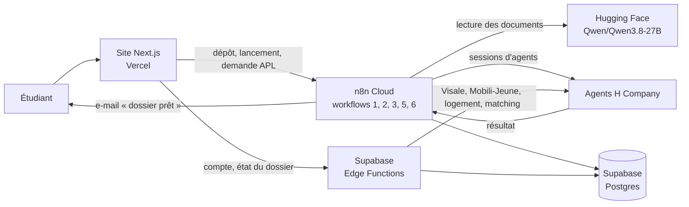

# Passerelle

**Le copilote du financement étudiant.** Passerelle aide un étudiant ou un alternant à trouver les aides auxquelles il a droit (APL, bourse du Crous, prime d'activité, prêt étudiant garanti, Visale, Mobili-Jeune…), à déposer ses documents une seule fois, puis à faire ses démarches avec des agents IA. **L'étudiant valide toujours avant tout envoi.**

Projet réalisé pour le hackathon **« Build The Future » 2026** (Eugenia School × H Company).

- Site : https://passerelle-drab.vercel.app
- Consignes du hackathon : [`docs/consignes-hackathon-2026.pdf`](docs/consignes-hackathon-2026.pdf)
- Audit qualité de l'interface : [`docs/audit-qa-ema-lamyaa.pdf`](docs/audit-qa-ema-lamyaa.pdf)

## Le parcours

1. **Compte** : création avec e-mail et mot de passe ; mot de passe oublié par e-mail.
2. **Situation et questionnaire** : logement, activité, bourse, puis les questions propres à chaque aide.
3. **Documents** : pièce d'identité, certificat de scolarité, bail, fiche de paie, avis d'imposition… La liste s'adapte à la situation. Les documents sont lus par un modèle de vision, puis contrôlés entre eux (noms, adresses, dates, montants).
4. **Mes aides** : éligibilité calculée à partir du profil et des documents.
5. **Choix** : l'étudiant coche les aides à lancer.
6. **Suivi en direct** : chaque agent H travaille sur le vrai site (caf.fr, etudiant.gouv.fr, banques…). On peut suivre son écran pas à pas et lui répondre.
7. **Validation** : montants estimés, comptes rendus des agents, fiches pré-remplies, puis lien vers le site officiel pour valider soi-même.

Il y a aussi une **recherche de logement** faite par un agent H, et un mini-jeu pendant l'attente.

## Architecture



| Brique | Rôle | Où |
|---|---|---|
| Site | Interface, comptes, parcours | `app/`, `components/`, `lib/` |
| n8n | Dépôt et lecture des documents, lancement des agents, retour des résultats, e-mail | [`n8n/`](n8n/README.md) |
| Supabase | Base de données, authentification, Edge Functions | [`supabase/`](supabase/README.md) |
| Hugging Face | Lecture des documents (vision) et contrôle croisé | workflow n8n 1 |
| H Company | Agents qui remplissent les simulateurs et les formulaires | voir ci-dessous |

### Agents H

| Agent | Ce qu'il fait | Lancé par |
|---|---|---|
| `simulateur-apl-caf` | Simulation de l'aide au logement sur caf.fr | n8n, workflow 2 |
| `simulateur-prime-activite-caf` | Simulation de la prime d'activité | n8n, workflow 2 |
| `simulateur-bourse` | Simulation de la bourse sur critères sociaux | n8n, workflow 2 |
| `comparateur-pret` | Comparaison des prêts étudiants des banques | n8n, workflow 2 |
| `demande-apl-caf` | Prépare la vraie demande d'APL et s'arrête au récapitulatif | n8n, workflow 6 |
| `demande-visale`, `demande-mobili-jeune` | Préparent une fiche pour faire la demande soi-même | Edge Function `demande-h` |
| `passerelle-logement` | Recherche d'annonces de logement | Edge Function `logement-h` |
| `passerelle-matching` | Matching des aides à partir du dossier | Edge Function `matching-h` |

Les agents ne valident et n'envoient jamais une demande : ils s'arrêtent avant le dernier bouton, et c'est l'étudiant qui valide sur le site officiel.

## Lancer le site en local

Il faut Node.js 20 ou plus récent et pnpm.

```bash
pnpm install
cp .env.example .env.local   # facultatif : sans ce fichier, le site utilise le projet actuel
pnpm dev                     # http://localhost:3000
```

Pour recréer tout le back-end ailleurs, suivre [`supabase/README.md`](supabase/README.md) puis [`n8n/README.md`](n8n/README.md).

## Organisation du dépôt

```
app/          Pages : accueil, connexion, situation, documents, aides, choix, agents (suivi),
              validation, recherche-logement, profil, informations, fenetre-agent
components/   Composants, rangés par étape (documents/, aides/, choix/, agents/, validation/, compte/…)
lib/          Logique : appels n8n et Supabase, comptes, questionnaire, documents, éligibilité
public/       Icônes, logo et documents-test/ (documents fictifs pour essayer le parcours)
n8n/          Exports des workflows n8n
supabase/     Structure de la base, catalogue des aides et Edge Functions
docs/         Consignes du hackathon, audit qualité
```

## Documents de test

`public/documents-test/` contient deux profils **entièrement fictifs**, marqués « spécimen » :

- **Léa Martin** : locataire, salariée (bail, fiche de paie, avis d'imposition…), pour l'APL et la prime d'activité ;
- **Tom Dubois** : étudiant à temps plein qui vit chez ses parents, aux revenus modestes, pour la bourse du Crous.

## Données et sécurité

- Les documents ne sont analysés qu'avec l'accord de l'étudiant. Les photos sont supprimées automatiquement au bout de 30 jours.
- Aucune clé secrète dans le site ni dans ce dépôt : les clés (Hugging Face, H, SMTP, clé de service Supabase) sont rangées dans n8n et dans les secrets Supabase.
- Le dépôt ne contient aucune donnée d'étudiant.
- Mentions légales, CGU et politique de confidentialité : page `/informations` du site.
