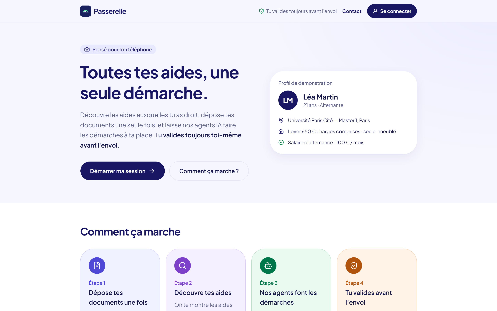
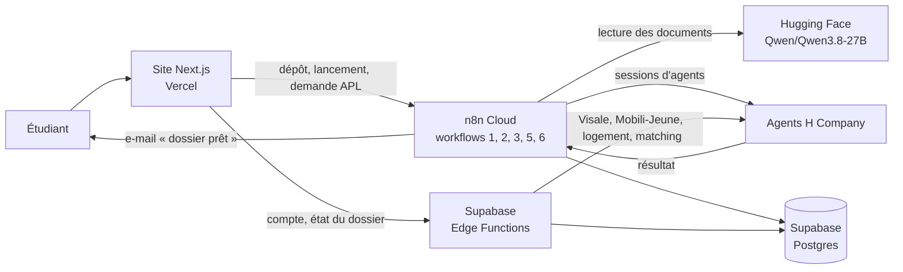

# Passerelle

**Le copilote du financement étudiant.** Passerelle aide un étudiant ou un alternant à trouver les aides auxquelles il a droit (APL, bourse du Crous, prime d'activité, prêt étudiant garanti, Visale, Mobili-Jeune…), à déposer ses documents une seule fois, puis à faire ses démarches avec des agents IA. **L'étudiant valide toujours avant tout envoi.**

Projet de la **Team 1** pour le hackathon **« Build The Future » 2026** (Eugenia School × H Company, Hugging Face, Vercel).

**👉 Site en ligne : https://passerelle-drab.vercel.app**



## Sommaire

[Le problème](#le-problème) · [La solution](#la-solution) · [Tester en 3 minutes](#tester-en-3-minutes) · [Le parcours](#le-parcours) · [Architecture](#architecture) · [Stack](#stack) · [Business model](#business-model) · [Lancer en local](#lancer-le-site-en-local) · [Organisation du dépôt](#organisation-du-dépôt) · [Documents](#documents-du-projet) · [Équipe](#équipe)

## Le problème

Un étudiant qui a droit à l'APL, à la bourse, à la prime d'activité ou à un prêt garanti doit faire **une démarche par aide, sur un site différent** (caf.fr, messervices.etudiant.gouv.fr, visale.fr, Action Logement, sa banque…), en redonnant à chaque fois les mêmes justificatifs. Beaucoup abandonnent en route ou ne savent pas qu'ils y ont droit. Pour une école privée, un admis qui renonce faute de financement, c'est 6 000 à 18 000 € de frais de scolarité perdus par an.

**Cible :** les étudiants et alternants, à travers leur école (qui paie Passerelle pour eux).

## La solution

L'étudiant dépose ses documents **une seule fois** depuis son téléphone. Passerelle les lit, calcule les aides auxquelles il a droit, puis des **agents H Company** remplissent les simulateurs et les formulaires **sur les vrais sites officiels**, comme le ferait un humain. L'étudiant suit les agents en direct et **valide toujours lui-même** avant tout envoi.

**Pourquoi des agents computer-use et pas une simple automatisation ?** Aucun de ces sites n'a d'API publique : caf.fr, mesdroitssociaux.gouv.fr, visale.fr ou les simulateurs des banques ne s'utilisent qu'à travers leur interface. Un agent qui voit l'écran, clique et tape est la seule façon de les automatiser. n8n orchestre, les agents H agissent.

## Tester en 3 minutes

1. Ouvrir **https://passerelle-drab.vercel.app** (de préférence sur téléphone) et cliquer sur **Démarrer ma session**.
2. Créer un compte (e-mail + mot de passe).
3. Répondre aux questions de situation, puis déposer les documents fictifs du profil **Léa Martin** (alternante locataire), à télécharger dans [`public/documents-test/`](public/documents-test/) : pièce d'identité, bail, certificat de scolarité, avis d'imposition, fiche de paie.
4. Consulter **Mes aides**, cocher les démarches, puis suivre les **agents H** en direct dans le suivi.
5. Finir sur la page **Validation** : montants estimés, comptes rendus des agents, fiches pré-remplies.

Pour tester la bourse du Crous, utiliser le profil **Tom Dubois** (étudiant qui vit chez ses parents). Tous les documents sont fictifs et marqués « spécimen ».

## Le parcours

1. **Compte** : création avec e-mail et mot de passe ; mot de passe oublié par e-mail.
2. **Situation et questionnaire** : logement, activité, bourse, puis les questions propres à chaque aide.
3. **Documents** : pièce d'identité, certificat de scolarité, bail, fiche de paie, avis d'imposition… La liste s'adapte à la situation. Les documents sont lus par un modèle de vision, puis contrôlés entre eux (noms, adresses, dates, montants).
4. **Mes aides** : éligibilité calculée à partir du profil et des documents.
5. **Choix** : l'étudiant coche les aides à lancer.
6. **Suivi en direct** : chaque agent H travaille sur le vrai site (caf.fr, etudiant.gouv.fr, banques…). On peut suivre son écran pas à pas et lui répondre.
7. **Validation** : montants estimés, comptes rendus des agents, fiches pré-remplies, puis lien vers le site officiel pour valider soi-même.

Il y a aussi une **recherche de logement** faite par un agent H, et un mini-jeu pendant l'attente.

## Architecture



| Brique | Rôle | Où |
|---|---|---|
| Site | Interface, comptes, parcours | `app/`, `components/`, `lib/` |
| n8n | Dépôt et lecture des documents, lancement des agents, retour des résultats, e-mail | [`n8n/`](n8n/README.md) |
| Supabase | Base de données, authentification, Edge Functions | [`supabase/`](supabase/README.md) |
| Hugging Face | Lecture des documents (vision) et contrôle croisé | workflow n8n 1 |
| H Company | Agents qui remplissent les simulateurs et les formulaires | voir ci-dessous |

### Agents H

| Agent | Ce qu'il fait | Lancé par |
|---|---|---|
| `simulateur-apl-caf` | Simulation de l'aide au logement sur caf.fr | n8n, workflow 2 |
| `simulateur-prime-activite-caf` | Simulation de la prime d'activité | n8n, workflow 2 |
| `simulateur-bourse` | Simulation de la bourse sur critères sociaux | n8n, workflow 2 |
| `comparateur-pret` | Comparaison des prêts étudiants des banques | n8n, workflow 2 |
| `demande-apl-caf` | Prépare la vraie demande d'APL et s'arrête au récapitulatif | n8n, workflow 6 |
| `demande-visale`, `demande-mobili-jeune` | Préparent une fiche pour faire la demande soi-même | Edge Function `demande-h` |
| `passerelle-logement` | Recherche d'annonces de logement | Edge Function `logement-h` |
| `passerelle-matching` | Matching des aides à partir du dossier | Edge Function `matching-h` |

Les agents ne valident et n'envoient jamais une demande : ils s'arrêtent avant le dernier bouton, et c'est l'étudiant qui valide sur le site officiel.

Chaque passage d'agent est enregistré dans la table `passages_agents`. La vue `mesures_agents` (dans [`supabase/schema.sql`](supabase/schema.sql)) en tire, par site, le **taux de réussite**, la **durée moyenne**, les **crédits consommés** et le nombre de **montants justes** (écart d'1 € maximum avec le montant attendu).

## Stack

| Besoin | Outil |
|---|---|
| Interface | Next.js 16, React 19, Tailwind CSS 4, shadcn/ui (maquettée avec v0), hébergée sur Vercel |
| Orchestration | n8n Cloud (5 workflows) |
| Agents computer-use | H Company Agents API (modèle Holo) |
| Lecture des documents | Hugging Face Inference (Qwen/Qwen3.8-27B) |
| Base de données et comptes | Supabase (Postgres, Auth, Edge Functions en Deno, pg_cron) |

## Business model

**Gratuit pour l'étudiant, payé par l'école.** Détail complet : [`docs/business-model-v2.pdf`](docs/business-model-v2.pdf).

| Qui | Prix | Quoi |
|---|---|---|
| Étudiant | 0 € | Tout le parcours, agents compris (moteur d'acquisition) |
| École jusqu'à 500 étudiants | 1 900 € / an | Licence Starter et tableau de bord des admis financés ou bloqués |
| École de 500 à 1 500 étudiants | 3 900 € / an | Licence Campus (cœur de cible) |
| Groupe de plus de 1 500 étudiants | Sur devis | Plusieurs campus, un seul tableau de bord |
| Banque (phase 2) | 120 € / prêt débloqué | Commission, à partir du mois 6 |

**Coût de run :** un dossier complet coûte **0,41 €** en moyenne (lecture des documents par Hugging Face et agents H sur 6 démarches), avec un plafond de 0,83 € grâce à `max_steps`. L'infrastructure fixe coûte environ 100 € par mois. Marge brute : 66 % avec une école Campus, 89 % avec cinq.

## Lancer le site en local

Il faut Node.js 20 ou plus récent et pnpm.

```bash
pnpm install
cp .env.example .env.local   # facultatif : sans ce fichier, le site utilise le projet actuel
pnpm dev                     # http://localhost:3000
```

Pour recréer tout le back-end ailleurs, suivre [`supabase/README.md`](supabase/README.md) puis [`n8n/README.md`](n8n/README.md).

## Organisation du dépôt

```
app/          Pages : accueil, connexion, situation, documents, aides, choix, agents (suivi),
              validation, recherche-logement, profil, informations, fenetre-agent
components/   Composants, rangés par étape (documents/, aides/, choix/, agents/, validation/, compte/…)
lib/          Logique : appels n8n et Supabase, comptes, questionnaire, documents, éligibilité
public/       Icônes, logo et documents-test/ (documents fictifs pour essayer le parcours)
n8n/          Exports des workflows n8n
supabase/     Structure de la base, catalogue des aides et Edge Functions
docs/         Business model, consignes du hackathon, audit qualité, captures d'écran
```

## Documents du projet

| Document | Contenu |
|---|---|
| [`docs/business-model-v2.pdf`](docs/business-model-v2.pdf) | Modèle économique, grille tarifaire des écoles, coût de run et rentabilité |
| [`docs/audit-qa-ema-lamyaa.pdf`](docs/audit-qa-ema-lamyaa.pdf) | Audit qualité de l'interface |
| [`docs/consignes-hackathon-2026.pdf`](docs/consignes-hackathon-2026.pdf) | Consignes officielles du hackathon |
| [`n8n/README.md`](n8n/README.md) | Rôle de chaque workflow et comment les réimporter |
| [`supabase/README.md`](supabase/README.md) | Structure de la base et comment la recréer |

## Documents de test

`public/documents-test/` contient deux profils **entièrement fictifs**, marqués « spécimen » :

- **Léa Martin** : locataire, salariée (bail, fiche de paie, avis d'imposition…), pour l'APL et la prime d'activité ;
- **Tom Dubois** : étudiant à temps plein qui vit chez ses parents, aux revenus modestes, pour la bourse du Crous.

## Données et sécurité

- Les documents ne sont analysés qu'avec l'accord de l'étudiant. Les photos sont supprimées automatiquement au bout de 30 jours.
- Aucune clé secrète dans le site ni dans ce dépôt : les clés (Hugging Face, H, SMTP, clé de service Supabase) sont rangées dans n8n et dans les secrets Supabase.
- Le dépôt ne contient aucune donnée d'étudiant.
- Mentions légales, CGU et politique de confidentialité : page `/informations` du site.

## Équipe

Team 1 · Eugenia School : Margot Frappa, Noah Rebyffé, Yecin Maaref (M1) · Lamyaa Marzouq, Ema Fernandes (M2).
